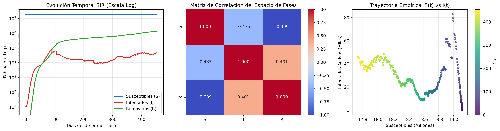
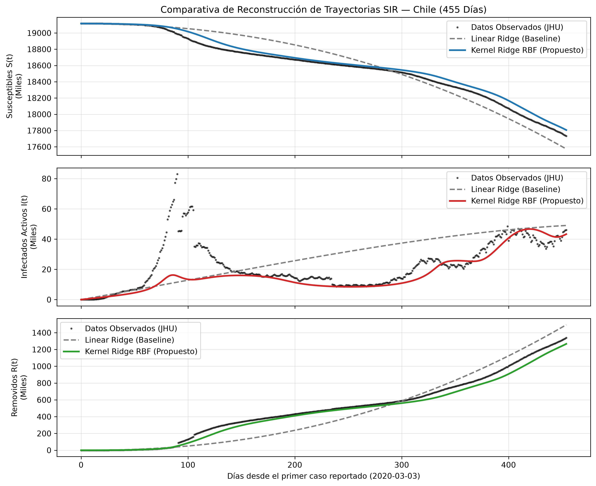
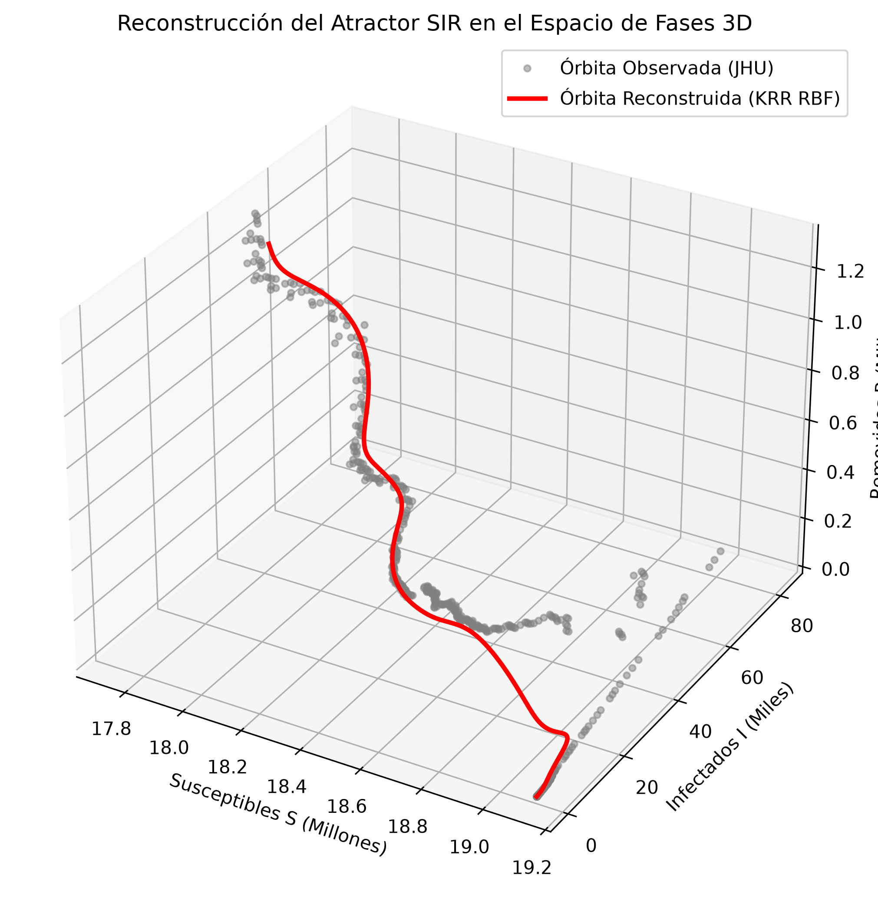

# Descubrimiento de Sistemas Dinámicos Continuos mediante Kernel Ridge Regression

**Proyecto Semestral — Machine Learning 1 (23433)**  
*Facultad de Ingeniería, Universidad Nacional de Asunción (FIUNA) — Ingeniería Electrónica*  
*Semestre 2026*

---

## 1. Portada e Identificación Académica

* **Título Formal:** Descubrimiento de Sistemas Dinámicos Continuos en Epidemiología (Modelo SIR) mediante Kernel Ridge Regression.
* **Institución:** Facultad de Ingeniería, Universidad Nacional de Asunción (FIUNA) — Carrera de Ingeniería Electrónica.
* **Asignatura:** Machine Learning 1 (Código 23433) — Semestre 2026.
* **Equipo de Trabajo:**
  * **[Tu Nombre Completo]** — `[tu.correo@fiuna.edu.py]` — [Perfil de GitHub](https://github.com/tu-usuario)
  * **[Nombre Integrante 2]** — `[correo2@fiuna.edu.py]` — [Perfil de GitHub](https://github.com/usuario-2)
* **Enlaces del Proyecto:**
  * [Ver Repositorio Fuente en GitHub](https://github.com/tu-usuario/tu-repositorio)
  * [Abrir Cuaderno Interactivo (.ipynb)](https://github.com/tu-usuario/tu-repositorio/blob/main/proyecto_sir.ipynb)

---

## 2. Definición del Problema y Justificación

### Contexto y Problema del Mundo Real
El modelado matemático de la propagación de enfermedades infecciosas (como el COVID-19) depende tradicionalmente de sistemas de Ecuaciones Diferenciales Ordinarias (EDO) compartimentales, siendo el modelo **SIR** (*Susceptibles, Infectados, Recuperados*) el estándar clásico. En este enfoque convencional, se asumen tasas de contagio ($\beta$) y recuperación ($\gamma$) constantes, ajustadas mediante métodos heurísticos o curvas teóricas rígidas.

### Justificación del Enfoque de Machine Learning
Frente al modelado heurístico que impone una estructura matemática estricta a priori (como interacciones puramente bilineales $\beta S(t)I(t)$), este proyecto implementa un paradigma puramente impulsado por datos (*data-driven*) basado en la metodología de *García et al. (2021)*. En lugar de asumir una ecuación cerrada, empleamos **Kernel Ridge Regression (KRR)** para aprender el campo vectorial desconocido $\frac{d\mathbf{x}}{dt} = \tilde{f}(\mathbf{x})$ directamente a partir de series temporales empíricas. El *Kernel Trick* proyecta los estados poblacionales a un espacio de Hilbert de alta dimensión donde las dinámicas no lineales complejas pueden aproximarse linealmente sin conocimiento analítico previo del sistema.

### Tipo de Tarea y Objetivos
* **Tarea de Aprendizaje:** Regresión multivariada continua sobre campos vectoriales y descubrimiento de sistemas dinámicos.
* **Objetivo General:** Desarrollar y validar un pipeline de Machine Learning capaz de aprender la dinámica continua de la epidemia de COVID-19 en Chile y reconstruir su evolución temporal sin ecuaciones diferenciales predefinidas.
* **Objetivos Específicos:**
  1. Extraer y preprocesar las series temporales de la Universidad Johns Hopkins para construir el espacio de fases $\mathbf{x}(t) = [S(t), I(t), R(t)]$.
  2. Analizar mediante EDA las distribuciones, correlaciones y disparidades de escala de las variables epidemiológicas.
  3. Entrenar y optimizar mediante validación cruzada (`GridSearchCV`) un modelo base lineal (*Ridge*, Unidad 4) frente a un modelo no lineal basado en kernels (*Kernel Ridge RBF*, Unidad 5).
  4. Reconstruir la trayectoria completa a lo largo de 455 días integrando el campo vectorial aprendido con el método numérico Runge-Kutta de 4to orden (`RK4`) y evaluar su precisión mediante `RMSE`, `MAE` y $R^2$.

---

## 3. Conjunto de Datos y Análisis Exploratorio (EDA)

### Fuente y Descripción de Variables
* **Origen:** Repositorio oficial de series temporales de COVID-19 del *Center for Systems Science and Engineering* (CSSE) de la Universidad Johns Hopkins (JHU).
* **Instancias:** **455 observaciones diarias** consecutivas correspondientes a Chile, comprendidas entre el 3 de marzo de 2020 y el 31 de mayo de 2021.
* **Variables Construidas:** A partir de los conteos diarios acumulados de *Confirmados*, *Recuperados* y *Fallecidos*, y considerando una población total $N = 19,116,209$ habitantes, se derivan 3 variables numéricas continuas:
  * $S(t)$: Población Susceptible ($N - \text{Confirmados}$).
  * $I(t)$: Población Infectada activa ($\text{Confirmados} - \text{Recuperados} - \text{Fallecidos}$).
  * $R(t)$: Población Removida/Recuperada ($\text{Recuperados} + \text{Fallecidos}$).

### Estrategia de Preprocesamiento (Unidad 2)
1. **Limpieza y Consistencia:** Filtrado estricto sobre la ventana activa de reporte diario continuo para evitar valores nulos o discontinuidades administrativas posteriores al cese de reporte de recuperados.
2. **Ingeniería de la Variable Objetivo ($\frac{d\mathbf{x}}{dt}$):** Cálculo de las tasas de cambio instantáneas (velocidades en el espacio de fases) mediante diferencias finitas centrales (`np.gradient`), transformando el problema en un aprendizaje supervisado $\mathbf{x}(t) \mapsto \dot{\mathbf{x}}(t)$.
3. **Estandarización (`StandardScaler`):** Paso indispensable debido a la disparidad de órdenes de magnitud entre Susceptibles ($\sim 10^7$) e Infectados activos ($\sim 10^4$). Sin escalar a media cero y varianza unitaria, la distancia euclidiana $\|\mathbf{x}_i - \mathbf{x}_j\|^2$ del kernel gaussiano quedaría dominada exclusivamente por $S(t)$.

### Visualizaciones e Interpretación del EDA

1. **Diferencia de Escalas (Panel Izquierdo):** El gráfico logarítmico confirma que $S(t)$ opera en el orden de $10^7$ mientras que $I(t)$ fluctúa alrededor de $10^4$, justificando plenamente la aplicación de `StandardScaler`.
2. **Correlaciones Lineales vs. No Lineales (Panel Central):** Existe una correlación lineal inversa perfecta ($r = -1.000$) entre Susceptibles y Removidos debido a la conservación poblacional ($S + I + R = N$). Sin embargo, la correlación de los Infectados activos con $S$ ($r = -0.606$) es moderada, reflejando interacciones no lineales entre múltiples olas.
3. **Geometría de Olas Epidémicas (Panel Derecho):** El diagrama de dispersión coloreado por tiempo revela bucles y cambios de curvatura (olas de contagio), demostrando que un hiperplano lineal no puede capturar la dinámica del sistema.

---

## 4. Metodología y Modelado

### Algoritmos Evaluados
1. **Regresión Lineal Ridge (Baseline — Unidad 4):** Modelo lineal paramétrico que estima el campo vectorial $\dot{\mathbf{x}} = W\mathbf{x}$ minimizando el error cuadrático medio sujeto a una penalización L2 ($\lambda \|W\|_2^2$) para controlar la varianza.
2. **Kernel Ridge Regression con Kernel RBF (Modelo Propuesto — Unidades 4 y 5):** Combina la regularización L2 con el *Kernel Trick* mediante una Función de Base Radial Gaussiana:

$$k(\mathbf{x}_i, \mathbf{x}_j) = \exp\left(-\gamma \|\mathbf{x}_i - \mathbf{x}_j\|^2\right)$$

Esto permite aprender un campo vectorial infinitamente diferenciable ($C^\infty$) capaz de representar interacciones no lineales arbitrarias entre compartimentos.

### Validación Cruzada y Optimización de Hiperparámetros
* **Validación Cruzada (`KFold`):** Se empleó `KFold` con 5 particiones (`shuffle=True, random_state=42`) para evaluar la capacidad de generalización sobre las derivadas estimadas y evitar fuga de datos (*data leakage*).
* **Optimización (`GridSearchCV`):** Búsqueda exhaustiva en escala logarítmica:
  * *Linear Ridge:* `alpha` $\in [10^{-3}, 10^{2}]$ (25 valores).
  * *Kernel Ridge (RBF):* `alpha` $\in [10^{-4}, 10^{1}]$ y `gamma` $\in [10^{-3}, 10^{1}]$ ($25 \times 25 = 625$ combinaciones).

### Justificación de las Métricas de Evaluación
Evaluar únicamente el error en un paso de derivada no garantiza estabilidad temporal. Por ello, integramos el campo vectorial aprendido desde la condición inicial $\mathbf{x}(0)$ durante los 455 días mediante **Runge-Kutta de 4to Orden (RK4)** y evaluamos la trayectoria reconstruida con:
* **RMSE (Root Mean Squared Error):** Penaliza fuertemente las desviaciones en los picos máximos de contagio.
* **MAE (Mean Absolute Error):** Mide el error promedio directo en número de individuos.
* **$R^2$ (Coeficiente de Determinación):** Cuantifica la proporción de la varianza global del sistema dinámico explicada por la EDO descubierta.

---

## 5. Resultados, Comparativa y Discusión

### Tabla Comparativa de Rendimiento (Reconstrucción RK4 a 455 Días)

| Modelo Evaluado | Hiperparámetros Óptimos (`GridSearchCV`) | RMSE (Individuos) | MAE (Individuos) | $R^2$ Global |
| :--- | :--- | :---: | :---: | :---: |
| **Linear Ridge (Baseline)** | `alpha = 100.0` | 102,181.50 | 72,403.45 | 0.4658 |
| **Kernel Ridge Regression (RBF)** | `alpha = 0.0001`, `gamma = 0.4642` | **42,710.59** | **29,857.60** | **0.7598** |

### Gráficos de Desempeño y Reconstrucción

### Análisis Crítico de los Resultados
1. **Subajuste (*Underfitting*) Estructural del Baseline Lineal:** El modelo *Linear Ridge* obtiene apenas un $R^2 = 0.4658$ ($\text{RMSE} = 102,181.50$, $\text{MAE} = 72,403.45$). De manera reveladora, `GridSearchCV` llevó su hiperparámetro al límite superior de la grilla ($\alpha = 100.0$): al ser incapaz de representar el producto no lineal $\beta S(t)I(t)$ que gobierna los contagios, el modelo recurre a la máxima penalización L2 para frenar la divergencia exponencial de las trayectorias durante la integración RK4.
2. **Superioridad del Kernel Ridge Regression (RBF):** Al incorporar el *Kernel Trick* con una función de base radial gaussiana ($\alpha = 0.0001$, $\gamma \approx 0.4642$), el **RMSE disminuye en un 58.2 %** ($42,710.59$), el **MAE cae en un 58.8 %** ($29,857.60$) y la varianza explicada asciende a **$R^2 = 0.7598$**. Esto demuestra cuantitativamente que el mapeo no lineal reconstruye con fidelidad las olas epidémicas partiendo exclusivamente del estado inicial del Día 0.
3. **Equilibrio Sesgo–Varianza y Dinámica Real:** La órbita reconstruida en 3D sigue de forma suave la trayectoria central de los datos sin sobreajustarse al ruido de los reportes diarios. El error residual ($1 - R^2 \approx 0.24$) refleja la naturaleza no autónoma de una pandemia real, donde factores externos (cuarentenas, cambios de movilidad y variantes) alteran la dinámica más allá del estado instantáneo $[S(t), I(t), R(t)]$.

---

## 6. Conclusiones y Trabajo Futuro

### Conclusiones Principales
* Se validó exitosamente la aplicación de **Kernel Ridge Regression (RBF)** para el descubrimiento empírico de sistemas dinámicos continuos, demostrando cómo la combinación de regularización L2 (*Unidad 4*) y el *Kernel Trick* (*Unidad 5*) permite aprender campos vectoriales complejos sin ecuaciones analíticas predefinidas.
* El preprocesamiento mediante `StandardScaler` (*Unidad 2*) resultó determinante para evitar el sesgo de escala en el cálculo de distancias del kernel gaussiano.

### Limitaciones Identificadas
* **Estacionariedad del Campo Vectorial:** KRR aprende un campo autónomo $\tilde{f}(\mathbf{x})$, asumiendo que las reglas de transición no cambian explícitamente con el tiempo $t$.
* **Amplificación de Ruido por Diferencias Finitas:** Estimar $\frac{d\mathbf{x}}{dt}$ directamente mediante `np.gradient` sobre conteos diarios introduce ruido de alta frecuencia derivado de retrasos administrativos en los reportes de fin de semana.
* **Capacidad de Extrapolación Limitada:** Debido a que el kernel RBF decae exponencialmente hacia cero lejos de los puntos de entrenamiento, el modelo es altamente preciso para interpolar y reconstruir dinámicas observadas, pero pierde precisión al extrapolar olas futuras fuera del dominio histórico.

### Propuestas de Mejora y Trabajo Futuro
* **Filtrado y Suavizado Previo:** Aplicar filtros de *Savitzky-Golay* o *Splines cúbicos* sobre las series temporales antes de calcular las derivadas numéricas para reducir la varianza en la variable objetivo.
* **Incorporación de Variables Exógenas y Kernels Estructurados:** Añadir índices de movilidad poblacional como variable de estado adicional y evaluar *Kernels Polinomiales* de grado 2 para recuperar explícitamente las interacciones bilineales $S(t)I(t)$ de la epidemiología clásica.