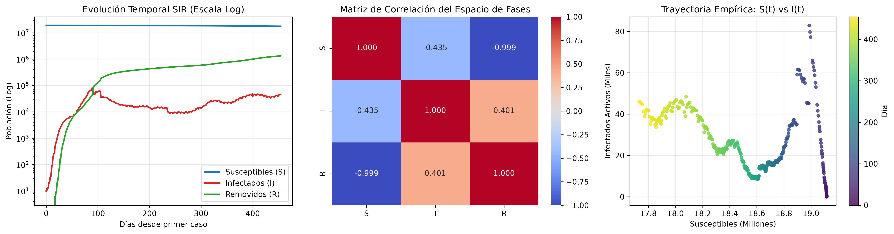
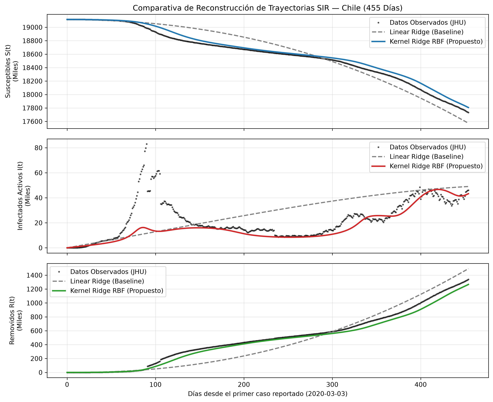
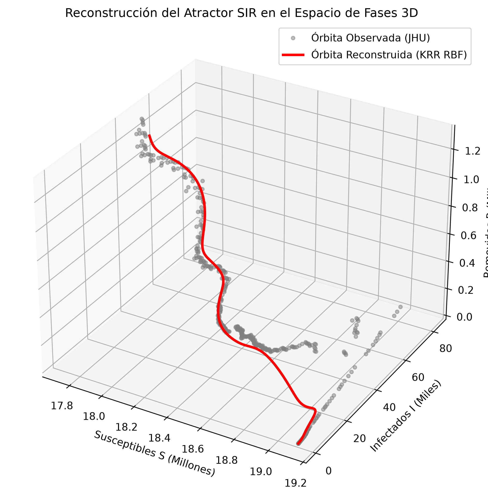

# Descubrimiento de Sistemas Dinámicos Continuos mediante Machine Learning

## Caso de estudio: dinámica epidemiológica SIR de Chile (2020–2021)

**Proyecto semestral — Machine Learning I (23433)**  

**Institución:** Facultad de Ingeniería, Universidad Nacional de Asunción (FIUNA)  

**Carrera:** Ingeniería Electrónica  

**Periodo académico:** 2026.2  

**Integrante:** Marcos Maldonado — [@marcosm2137](https://github.com/marcosm2137)

**Enlaces del proyecto:**

- [Repositorio fuente en GitHub](https://github.com/marcosm2137/ML1-2026.2_MarcosMaldonado)

- [Notebook del proyecto](https://github.com/marcosm2137/ML1-2026.2_MarcosMaldonado/blob/main/ProyectoFinal/proyectoFinal.ipynb)

---

## 1. Definición del problema y objetivos

### Contexto

El modelado de epidemias suele realizarse mediante sistemas de ecuaciones diferenciales ordinarias (EDO) compartimentales. Uno de los enfoques clásicos es el modelo SIR, que divide a la población en tres grupos:

- **Susceptibles (S):** personas que aún pueden contraer la enfermedad.

- **Infectados (I):** personas que se encuentran activamente infectadas.

- **Removidos (R):** personas recuperadas o fallecidas.

Los modelos epidemiológicos tradicionales suelen definir explícitamente parámetros como las tasas de transmisión y recuperación. Sin embargo, las dinámicas reales pueden presentar relaciones no lineales y variaciones que dificultan la identificación de una estructura matemática fija.

En este proyecto se utiliza un enfoque basado en datos (*data-driven*) para aproximar directamente el campo vectorial de un sistema dinámico continuo mediante algoritmos de Machine Learning.

### Pregunta de investigación

¿Es posible aprender un campo vectorial continuo a partir de observaciones epidemiológicas históricas y utilizarlo para pronosticar la evolución de un sistema SIR, comparando un modelo lineal Ridge con Kernel Ridge Regression utilizando un kernel de base radial (RBF)?

### Objetivo general

Desarrollar y evaluar un procedimiento de aprendizaje automático capaz de aproximar la dinámica continua de la epidemia de COVID-19 en Chile y generar pronósticos fuera de muestra mediante integración numérica.

### Objetivos específicos

1. Construir las variables SIR a partir de las series históricas de casos confirmados, recuperados y fallecidos.

2. Realizar un análisis exploratorio de los datos y estudiar sus relaciones temporales y geométricas.

3. Estimar las derivadas del sistema mediante diferencias finitas hacia adelante.

4. Entrenar y optimizar modelos Ridge y Kernel Ridge Regression con kernel RBF.

5. Integrar los campos vectoriales aprendidos mediante Runge-Kutta de cuarto orden (RK4).

6. Comparar los pronósticos con un modelo de persistencia utilizando métricas de error por compartimento.

---

## 2. Conjunto de datos y preprocesamiento

### Fuente de datos

Se utilizan las series temporales históricas del repositorio COVID-19 del Center for Systems Science and Engineering (CSSE) de la Universidad Johns Hopkins (JHU).

El conjunto de datos corresponde a Chile y contiene **455 observaciones diarias**, desde el **3 de marzo de 2020 hasta el 31 de mayo de 2021**.

Se utilizan las series acumuladas de:

- Casos confirmados.

- Casos recuperados.

- Fallecimientos.

Para construir el sistema SIR se considera una población constante de:

$$
N = 19.370.624
$$

Este valor corresponde a la estimación de población total de Chile para 2020 publicada por el Banco Mundial (indicador `SP.POP.TOTL`).

### Construcción de los compartimentos

A partir de los conteos acumulados se construyen las siguientes variables:

$$
S(t) = N - \operatorname{Confirmados}(t)
$$

$$
I(t) = \operatorname{Confirmados}(t)
- \operatorname{Recuperados}(t)
- \operatorname{Fallecidos}(t)
$$

$$
R(t) = \operatorname{Recuperados}(t)
+ \operatorname{Fallecidos}(t)
$$

Por construcción:

$$
S(t)+I(t)+R(t)=N
$$

La variable de infectados representa una aproximación contable de los casos activos y no necesariamente el número real de personas infecciosas en cada fecha.

### Preprocesamiento

Se aplica una media móvil retrospectiva de siete días (`center=False`) para reducir parte de la variabilidad de los reportes diarios. Al ser causal, el suavizado utiliza únicamente observaciones pasadas y actuales.

El experimento utiliza una partición cronológica 80/20:

| Conjunto | Periodo | Observaciones |
|---|---|---:|
| Entrenamiento | 2020-03-03 a 2021-03-01 | 364 |
| Prueba | 2021-03-02 a 2021-05-31 | 91 |
| Total | 2020-03-03 a 2021-05-31 | 455 |

El conjunto de prueba permanece separado durante el escalado, la validación cruzada, la selección de hiperparámetros y el ajuste final.

---

## 3. Análisis exploratorio de datos (EDA)

El análisis exploratorio permite examinar la evolución temporal de los compartimentos, las relaciones entre variables y la geometría del sistema en el espacio de fases.

**Figura 1. Análisis exploratorio del sistema SIR.** Se presentan la evolución temporal de los compartimentos, la matriz de correlación y la representación del espacio de fases entre susceptibles e infectados.

La identidad de conservación poblacional introduce una dependencia algebraica entre S, I y R. Por ello, las correlaciones observadas no deben interpretarse como relaciones causales independientes.

Las diferencias de escala entre los compartimentos también justifican el uso de estandarización dentro de los modelos de aprendizaje.

---

## 4. Metodología y modelado

### 4.1 Formulación del sistema dinámico

Se considera el vector de estado:

$$
\mathbf{x}(t) =
\begin{bmatrix}
S(t)\\
I(t)\\
R(t)
\end{bmatrix}
$$

El objetivo es aproximar un sistema autónomo de ecuaciones diferenciales:

$$
\dot{\mathbf{x}} = f(\mathbf{x})
$$

En lugar de imponer una estructura epidemiológica paramétrica con tasas constantes, se utilizan modelos de regresión para aprender componentes del campo vectorial directamente desde los datos.

### 4.2 Estimación de derivadas

Las derivadas se aproximan mediante diferencias finitas hacia adelante entre estados suavizados consecutivos:

$$
\dot{\mathbf{x}}_i \approx
\frac{\mathbf{x}_{i+1,\mathrm{smooth}}
-\mathbf{x}_{i,\mathrm{smooth}}}
{t_{i+1}-t_i}
$$

A partir de los 364 estados suavizados del conjunto de entrenamiento se obtienen **363 transiciones**.

Cada entrada corresponde al estado inicial completo:

$$
\mathbf{x}_i=[S_i,I_i,R_i]
$$

Se estiman dos derivadas independientes:

$$
\dot I=f_I(S,I,R)
$$

$$
\dot R=f_R(S,I,R)
$$

La derivada del compartimento susceptible se reconstruye mediante la condición de conservación:

$$
\dot S=-\dot I-\dot R
$$

El tiempo no se incluye como variable de entrada del modelo.

### 4.3 Algoritmos evaluados

**Ridge Regression**

Se utiliza como línea base lineal. Minimiza el error cuadrático incorporando una penalización L2 sobre los coeficientes:

$$
J(W)=\|Y-XW\|_2^2+\alpha\|W\|_2^2
$$

**Kernel Ridge Regression (RBF)**

Se utiliza para representar relaciones no lineales en el campo vectorial mediante el kernel gaussiano:

$$
k(\mathbf{x}_i,\mathbf{x}_j)=
\exp\left(-\gamma
\|\mathbf{x}_i-\mathbf{x}_j\|^2\right)
$$

El parámetro $\alpha$ controla la regularización y $\gamma$ determina la escala de influencia del kernel.

### 4.4 Validación y selección de hiperparámetros

Se emplea validación cruzada cronológica con cinco particiones (`TimeSeriesSplit`) y una separación de siete observaciones (`gap=7`). No se mezclan aleatoriamente las observaciones.

El escalado de las entradas y los objetivos se incorpora dentro de los estimadores, de manera que cada partición ajusta sus propios escaladores.

La selección se realiza en dos etapas:

1. `GridSearchCV` busca los hiperparámetros iniciales por separado para las derivadas de infectados y recuperados. El criterio principal es el error cuadrático medio (`neg_mean_squared_error`), mientras que $R^2$ se conserva como métrica complementaria.

2. Una búsqueda local por coordenadas refina los parámetros utilizando el error RMSE normalizado de las trayectorias integradas de los compartimentos I y R en las particiones de validación.

Los hiperparámetros finales se reajustan utilizando todas las transiciones del conjunto de entrenamiento.

| Modelo | Objetivo | Hiperparámetros finales |
|---|---|---|
| Ridge | $dI/dt$ | $\alpha=1581.1388$ |
| Ridge | $dR/dt$ | $\alpha=250.0$ |
| KRR RBF | $dI/dt$ | $\alpha=2.5,\ \gamma=0.06947$ |
| KRR RBF | $dR/dt$ | $\alpha=0.05,\ \gamma=0.01526$ |

### 4.5 Integración numérica y conservación

Los campos vectoriales aprendidos se integran mediante el método clásico de Runge-Kutta de cuarto orden (RK4), utilizando cinco subpasos por día.

La condición:

$$
\dot S+\dot I+\dot R=0
$$

garantiza la conservación de la población total durante la integración, salvo pequeños errores numéricos de punto flotante.

Los pronósticos comienzan en el último estado suavizado conocido del entrenamiento, correspondiente al 1 de marzo de 2021, y se extienden durante los 91 días del conjunto de prueba.

También se utiliza un modelo de persistencia como referencia, que mantiene constante el último estado conocido del entrenamiento durante todo el horizonte de prueba.

---

## 5. Resultados y evaluación fuera de muestra

La evaluación principal compara los pronósticos con las observaciones suavizadas causalmente del período de prueba. También se realiza un análisis de sensibilidad utilizando los conteos diarios originales sin suavizar.

Las métricas se calculan por compartimento:

- **RMSE:** raíz del error cuadrático medio.

- **MAE:** error absoluto medio.

- **R²:** coeficiente de determinación.

- **WAPE:** error porcentual absoluto ponderado.

### 5.1 Métricas sobre la serie suavizada

| Compartimento | Modelo | RMSE (personas) | MAE (personas) | R² | WAPE (%) |
|---|---|---:|---:|---:|---:|
| S | Ridge | 144,567.43 | 120,683.92 | 0.221 | 0.660 |
| S | KRR RBF | 61,878.40 | 53,407.41 | 0.857 | 0.292 |
| S | Persistencia | 313,340.52 | 267,101.28 | -2.658 | 1.461 |
| I | Ridge | 18,261.75 | 17,117.41 | -8.924 | 44.662 |
| I | KRR RBF | 8,322.13 | 6,709.16 | -1.061 | 17.505 |
| I | Persistencia | 16,592.51 | 15,546.94 | -7.193 | 40.564 |
| R | Ridge | 128,195.50 | 103,566.51 | 0.364 | 9.904 |
| R | KRR RBF | 57,241.19 | 47,049.74 | 0.873 | 4.499 |
| R | Persistencia | 298,560.36 | 251,554.35 | -2.447 | 24.057 |

KRR obtuvo los menores valores de RMSE y MAE en los tres compartimentos. Para el compartimento infectado, el MAE disminuyó aproximadamente un 60.8 % respecto de Ridge y un 56.8 % respecto de Persistencia.

### 5.2 Sensibilidad ante los datos diarios sin suavizar

| Compartimento | Modelo | RMSE (personas) | MAE (personas) |
|---|---|---:|---:|
| S | Ridge | 160,442.72 | 138,792.94 |
| S | KRR RBF | 78,532.10 | 71,516.42 |
| S | Persistencia | 329,365.45 | 285,210.30 |
| I | Ridge | 18,825.26 | 17,813.24 |
| I | KRR RBF | 9,018.32 | 7,402.48 |
| I | Persistencia | 17,171.11 | 16,242.76 |
| R | Ridge | 143,320.73 | 120,979.70 |
| R | KRR RBF | 72,988.60 | 64,434.53 |
| R | Persistencia | 314,065.27 | 268,967.54 |

La ventaja de KRR también se mantiene al evaluar los conteos diarios originales. Para los infectados, su MAE fue de 7,402.48 personas, frente a 17,813.24 de Ridge y 16,242.76 de Persistencia.

### 5.3 Interpretación de las métricas

Aunque KRR obtuvo los menores errores absolutos, el valor de $R^2$ del compartimento infectado sigue siendo negativo:

$$
R^2_I=-1.061
$$

en la serie suavizada, y:

$$
R^2_I=-1.622
$$

en los datos diarios sin suavizar.

Un $R^2$ negativo indica que el error cuadrático del pronóstico supera al de un predictor constante basado en la media del conjunto de prueba. Esto no implica necesariamente un desempeño inferior al modelo de Persistencia, porque ambos utilizan referencias diferentes.

Por lo tanto, el resultado debe interpretarse considerando conjuntamente RMSE, MAE, R² y WAPE.

### 5.4 Pronósticos temporales

**Figura 2. Pronósticos fuera de muestra para los compartimentos S, I y R.** Se muestran las observaciones originales y suavizadas, las trayectorias pronosticadas por Ridge y KRR RBF, y el límite entre los períodos de entrenamiento y prueba.

### 5.5 Reconstrucción tridimensional del sistema SIR

**Figura 3. Trayectorias en el espacio de estados SIR.** Se comparan la trayectoria de entrenamiento, la trayectoria observada durante el período de prueba y las trayectorias pronosticadas por Ridge y KRR RBF.

---

## 6. Análisis del pico de infectados y diagnósticos numéricos

### 6.1 Estimación del pico de infectados

El máximo observado de infectados suavizados durante el período de prueba fue de aproximadamente **44,994 personas**, registrado el **17 de abril de 2021** (día 47 del horizonte).

| Referencia / Modelo | Fecha del pico | Infectados | Error de magnitud | Error temporal |
|---|---|---:|---:|---:|
| Observado | 2021-04-17 | 44,994 | 0.00 % | 0 días |
| Ridge | 2021-03-02 | 22,761 | -49.41 % | -46 días |
| KRR RBF | 2021-05-31 | 40,695 | -9.55 % | +44 días |

KRR aproximó mejor la magnitud del pico, con una subestimación de aproximadamente 9.55 %. Sin embargo, su máximo pronosticado se encuentra en el último día del horizonte de prueba.

Por ello, este valor representa el máximo dentro del período evaluado y no una estimación confirmada del pico epidémico definitivo.

Ridge, por su parte, subestimó notablemente la magnitud del pico y ubicó su máximo al inicio del período de prueba.

### 6.2 Conservación y positividad

La conservación poblacional se impone algebraicamente durante la construcción del campo vectorial:

$$
\dot S=-\dot I-\dot R
$$

Los diagnósticos numéricos de las trayectorias de prueba fueron:

| Modelo | Error máximo de conservación | Estados negativos |
|---|---:|---:|
| Ridge | $1.49\times10^{-8}$ | 0 |
| KRR RBF | $1.86\times10^{-8}$ | 0 |

Ambos modelos produjeron trayectorias finitas, conservaron la población total dentro de la precisión numérica y no presentaron valores negativos en los compartimentos durante el horizonte evaluado.

---

## 7. Discusión y limitaciones

Los resultados indican que KRR RBF representa mejor las relaciones no lineales del sistema que la línea base Ridge en términos de RMSE y MAE sobre el bloque de prueba. También supera al modelo de Persistencia en los errores absolutos de los tres compartimentos.

Sin embargo, el desempeño no es uniforme en todas las dimensiones de evaluación. El R² negativo de los infectados y el retraso de 44 días en la estimación del pico muestran que una reducción del error absoluto no garantiza una reproducción precisa de los cambios epidemiológicos ni de sus puntos de inflexión.

Entre las principales limitaciones se encuentran:

- **Aproximación de infectados activos:** la expresión $I=\text{Confirmados}-\text{Recuperados}-\text{Fallecidos}$ es una construcción contable a partir de registros históricos y no necesariamente refleja la cantidad real de personas infecciosas.

- **Dinámica autónoma:** el campo vectorial supone que un mismo estado SIR produce siempre las mismas derivadas. No incorpora explícitamente cambios temporales en políticas sanitarias, movilidad, vacunación o variantes.

- **Calidad de los registros:** las revisiones administrativas y los cambios en los criterios de notificación pueden producir discontinuidades y ruido en las series.

- **Suavizado:** la media móvil causal reduce parte de la variabilidad diaria, pero también puede atenuar o desplazar cambios bruscos.

- **Horizonte de evaluación:** los resultados corresponden a una única partición cronológica de 91 días y no garantizan el mismo desempeño en otros períodos epidemiológicos.

- **Incertidumbre:** el procedimiento genera pronósticos deterministas y no proporciona intervalos de predicción ni cuantifica explícitamente la incertidumbre.

Además, el cumplimiento de la conservación poblacional es una restricción algebraica impuesta por construcción. No demuestra que el sistema aprendido represente todos los mecanismos epidemiológicos de un modelo SIR mecanístico.

---

## 8. Conclusiones

En este experimento, Kernel Ridge Regression con kernel RBF obtuvo el mejor desempeño general entre los modelos evaluados, superando a Ridge lineal y Persistencia en RMSE y MAE para los tres compartimentos del conjunto de prueba.

La mejora también se mantiene al comparar los pronósticos con las observaciones diarias originales sin suavizar, lo que indica que el desempeño de KRR no depende exclusivamente del suavizado aplicado durante el preprocesamiento.

La integración mediante RK4 generó trayectorias numéricamente estables, conservando la población total y manteniendo la no negatividad de los compartimentos durante los 91 días evaluados.

No obstante, el R² negativo para los infectados y el error temporal en la estimación del pico evidencian limitaciones en la representación de las variaciones y los puntos de inflexión de la epidemia.

En conclusión, los resultados respaldan el uso de KRR RBF como una alternativa no lineal prometedora para aproximar sistemas dinámicos continuos a partir de datos epidemiológicos. Sin embargo, sus pronósticos deben interpretarse como una aproximación experimental y no como predicciones epidemiológicas operacionales.

### Trabajo futuro

Como posibles extensiones se proponen:

- Incorporar variables exógenas, como movilidad, vacunación e intervenciones sanitarias.

- Evaluar campos vectoriales no autónomos que permitan representar cambios temporales en la dinámica.

- Comparar diferentes métodos de suavizado y estimación de derivadas.

- Evaluar múltiples ventanas cronológicas de entrenamiento y prueba.

- Incorporar métodos para cuantificar la incertidumbre de los pronósticos.

---

## 9. Referencias

1. Kermack, W. O., & McKendrick, A. G. (1927). A contribution to the mathematical theory of epidemics. *Proceedings of the Royal Society A, 115*(772), 700–721. https://doi.org/10.1098/rspa.1927.0118

2. Johns Hopkins University, Center for Systems Science and Engineering (JHU CSSE). *COVID-19 Data Repository*. https://github.com/CSSEGISandData/COVID-19

3. World Bank. *Population, total (SP.POP.TOTL): Chile*. World Development Indicators. https://data.worldbank.org/indicator/SP.POP.TOTL?locations=CL

4. García, P. (2022). Modeling systems with machine learning based differential equations. *Chaos, Solitons & Fractals, 165*, Article 112872. https://doi.org/10.1016/j.chaos.2022.112872

5. Hoerl, A. E., & Kennard, R. W. (1970). Ridge regression: Biased estimation for nonorthogonal problems. *Technometrics, 12*(1), 55–67. https://doi.org/10.1080/00401706.1970.10488634

6. Pedregosa, F., et al. (2011). Scikit-learn: Machine learning in Python. *Journal of Machine Learning Research, 12*, 2825–2830. https://www.jmlr.org/papers/v12/pedregosa11a.html
